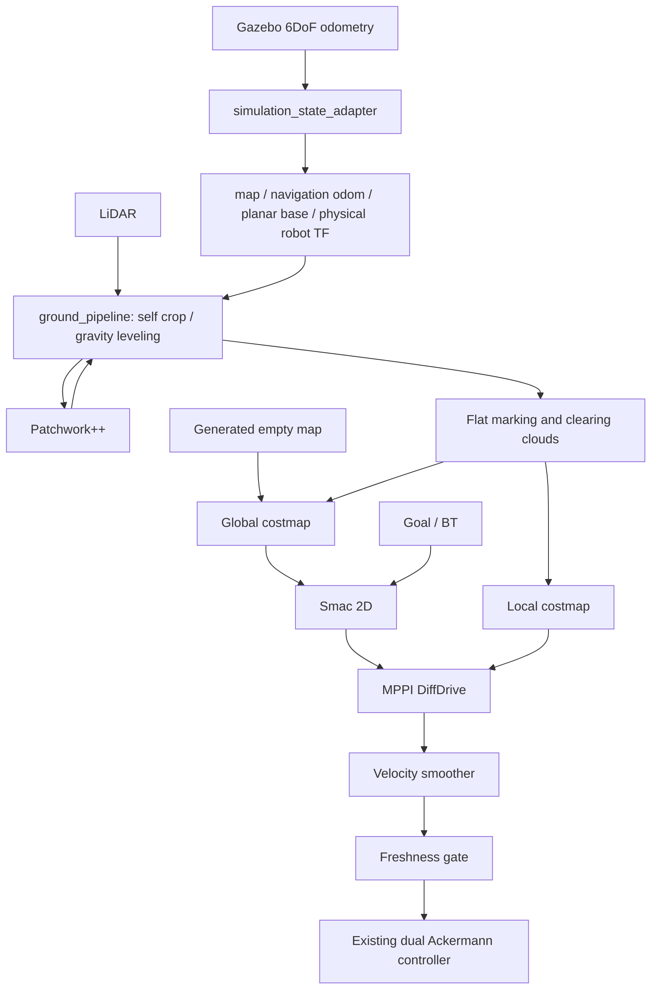

# rough_terrain_navigation

ROS 2 Humble / Gazebo Fortress용 FW-max swerve 기본 goal navigation.
기존 패키지 소스를 수정하지 않고 원본 지형, 로봇 Xacro, 제어기를 재사용합니다.

## 실행

```bash
cd ~/ros2_ws
source /opt/ros/humble/setup.bash
source install/setup.bash
colcon build --packages-select rough_terrain_navigation --symlink-install
source install/setup.bash
export RMW_IMPLEMENTATION=rmw_fastrtps_cpp
export ROS_DOMAIN_ID=42
ros2 launch rough_terrain_navigation simulation.launch.py
```

GUI 없이 서버만 실행: `gui:=false rviz:=false` (센서 렌더링용 OpenGL 환경은 필요).
기존 `rough_terrain_sim` launch와 동시에 실행하지 마세요.
카메라 ROS 브리지는 기본 비활성화이며 `camera:=true`로 RGB/Depth/PointCloud를 추가할 수 있습니다.
현재 환경에서 대용량 센서의 지연이 확인되어 launch의 기본 RMW는 Fast DDS입니다.
목표 전송/진단/RViz를 여는 다른 터미널도 위 RMW와 Domain ID를 동일하게 지정하세요.
Domain ID 42는 예시이며 다른 작업과 겹치지 않는 값을 선택할 수 있습니다.
`rmw_implementation` launch 인자로 변경 가능하나, CycloneDDS 기본 설정은 이 환경에서 큰 지연이 관찰되었습니다.
launch는 사용자 셸 설정이나 시스템 네트워크 설정을 수정하지 않습니다.

다른 터미널에서 지도 좌표의 목표점을 지정합니다.

```bash
source ~/ros2_ws/install/setup.bash
export RMW_IMPLEMENTATION=rmw_fastrtps_cpp
export ROS_DOMAIN_ID=42
ros2 run rough_terrain_navigation send_goal -14.259527 21.872246 --timeout 120 --ros-args -p use_sim_time:=true
```

또는 제공되는 RViz의 Navigation 2 Goal 도구를 사용합니다. AMCL/SLAM 및 초기 pose 입력은 사용하지 않습니다.

## RViz 컬러 지형 배경

기본 실행 시 시험장의 나무·바위와 지형 음영을 반영한 컬러 탑뷰가 표시됩니다.
`aerial_background:=false`로 끌 수 있습니다. Gazebo 없이 확인하려면
`ros2 launch rough_terrain_navigation aerial_view.launch.py`를 실행하세요.
구성 및 재생성 방법: [docs/AERIAL_BACKGROUND.md](docs/AERIAL_BACKGROUND.md).

## 기본값

- FW-max swerve, 제자리 회전 가능, MPPI DiffDrive body-twist 근사.
- 기본 스폰: **x=-15.259527206420898, y=21.87224578857422, z=1.30 m, yaw=0 rad**. 사용자가 지정한 XY 지점이며 기본 heightmap의 지면 높이는 약 1.24483 m.
  전달된 지도 클릭 z=-0.002017974853515625는 지형 높이가 아니므로 스폰 z에는 사용하지 않습니다.
  바퀴 접촉 기준 프레임을 지면보다 약 5.5 cm 높게 생성해 안착시킵니다.
  다른 heightmap 사용 시 robot_x/robot_y/robot_z launch 인자를 조정하세요.
- 최대 전진 0.2 m/s, 후진 0.1 m/s, 각속도 0.3 rad/s.
- 위치 허용오차 0.3 m, 방향 허용오차 pi rad.
- 지도 50 x 50 m, 원점 (-25, -25), 0.1 m/cell, 내부 free, 안쪽 0.3 m 경계 occupied.
- 나무/돌은 지도에 미리 넣지 않고 Patchwork++ nonground로 관측해 회피.
- Global/Local costmap 모두 관측된 일반 장애물을 반영. 전복 위험도는 계산하지 않음.
- 지면분리 초기 파라미터는 config/patchworkpp.yaml. 실제 경사/식생 분류 성능은 조정 필요.

## 구조



## 좌표계

`map -> navigation/odom`은 identity입니다. 두 프레임의 x/y는 Gazebo world와 같습니다.
`navigation/odom -> navigation/base`는 world x/y와 yaw, z=0입니다.
`navigation/base -> base_footprint`는 나머지 z/roll/pitch로, 전체 변환을 합하면 실제 6DoF가 복원됩니다.
원본 URDF의 `base_footprint -> base_link -> 센서`는 robot_state_publisher가 발행합니다.
Nav2는 `navigation/base`와 `/navigation/odom`을 사용합니다.
`/navigation/ground_truth`에는 map 좌표의 실제 3D pose가 보존됩니다.

LiDAR를 해당 측정 시각의 TF로 중력 정렬하되 원점은 센서에 유지하여 Patchwork++에 보냅니다.
`navigation/lidar_level`은 world 축과 평행한 센서 원점 프레임입니다.
분리 후 장애물/clearing 점군만 navigation/odom 평면 z=0.1로 투영합니다.
높이가 변하는 지면을 고정 world z 임계값으로 분리하지 않습니다.

## Patchwork++ 연결

설치된 ROS 패키지 이름은 `patchworkpp`, 실행 파일은 `demo`입니다.
한 입력마다 ground/nonground 두 출력을 모두 수신한 후 다음 입력을 보내므로,
신뢰성 있는 ground/nonground 결과 구독으로
설치된 upstream의 잘린 출력 stamp에 의존하지 않고 원래 입력 stamp를 복원합니다.
처리가 늦으면 새 LiDAR 프레임을 버리고, timeout/중복 출력 때는 연결부가 fault 상태가 됩니다.
이 경우 navigation을 재시작합니다. 상세사항은 docs/INTEGRATION_NOTES.md 참고.

주요 토픽:

| 토픽 | 의미 |
|---|---|
| /ground_truth/odom | 원본 Gazebo 3D state |
| /navigation/odom | Nav2용 world-aligned 평면 odometry |
| /navigation/ground_truth | map 기준 원본 3D pose |
| /navigation/patchwork/input | 정렬·필터링한 XYZI 입력 |
| /navigation/ground, /navigation/nonground | 시각을 복원한 지면 분리 결과 |
| /navigation/obstacles | 평면 투영된 장애물 marking |
| /navigation/clearing | 전체 관측의 평면 투영 clearing |
| /navigation/cmd_vel_smoothed | Nav2의 평활화된 명령 |
| /cmd_vel | freshness gate를 지난 실제 제어기 입력 |
| /navigation/command_status | 구동 허용/정지 이유 |
| /navigation/perception_status | 지면분리 상태 |

## 설정과 확장

`config/nav2.yaml`: Smac/MPPI, costmap, 속도 평활화, goal checker.
`config/fwmax_swerve.yaml`: 센서/TF, self crop, command gate.
`config/patchworkpp.yaml`: 지면분리.
`behavior_trees/navigate.xml`: 1 Hz 재계획, 대기/회전/후진 복구. 관측 장애물을 지우는 복구는 제외.

`navigation.launch.py`는 이미 준비된 시뮬레이션에 연결하는 모드입니다.
기존 launch의 `fwmax_planar_odometry` TF와 충돌하므로 그대로 병행하지 마세요.
현재 바로 실행 검증할 대상은 FW-max swerve뿐이며 다른 플랫폼은 새 profile/state bridge가 필요합니다.
사용자 알고리즘, grid_map, SLAM, AMCL은 의존성에 없습니다.
추후 local costmap에 별도 위험영역 layer를 추가할 수 있습니다.

지도만 생성:

```bash
ros2 run rough_terrain_navigation generate_empty_map --output-dir /tmp/empty_terrain_map
```

생성된 launch용 지도와 Nav2 YAML은 `/tmp/rough_terrain_navigation_*`에 보존합니다.
시험 조건 추적용이며 불필요한 실행 디렉터리는 사용자가 삭제할 수 있습니다.

## 검증

```bash
cd ~/ros2_ws
colcon test --packages-select rough_terrain_navigation --event-handlers console_direct+
colcon test-result --verbose
```

실제 실행 확인 범위와 남은 검증 항목은 docs/VALIDATION.md에 기록합니다.
